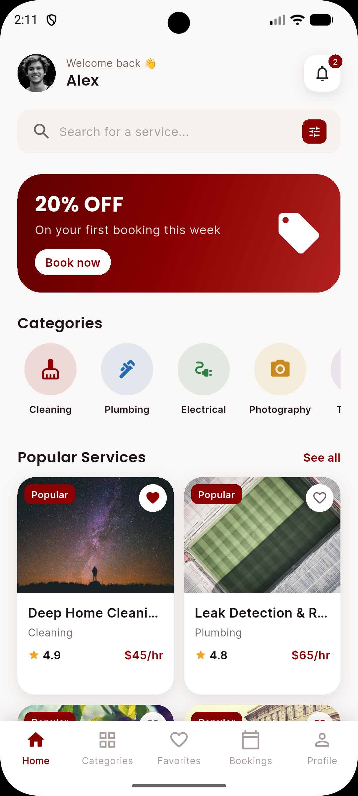
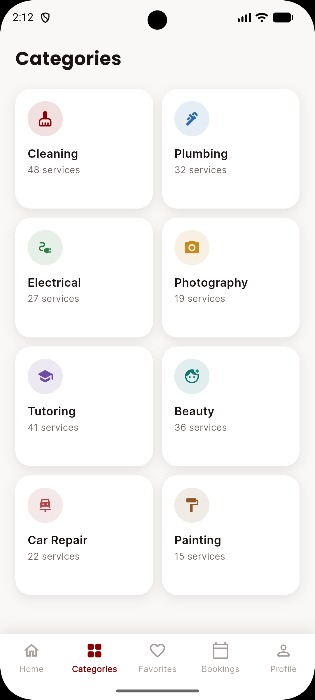
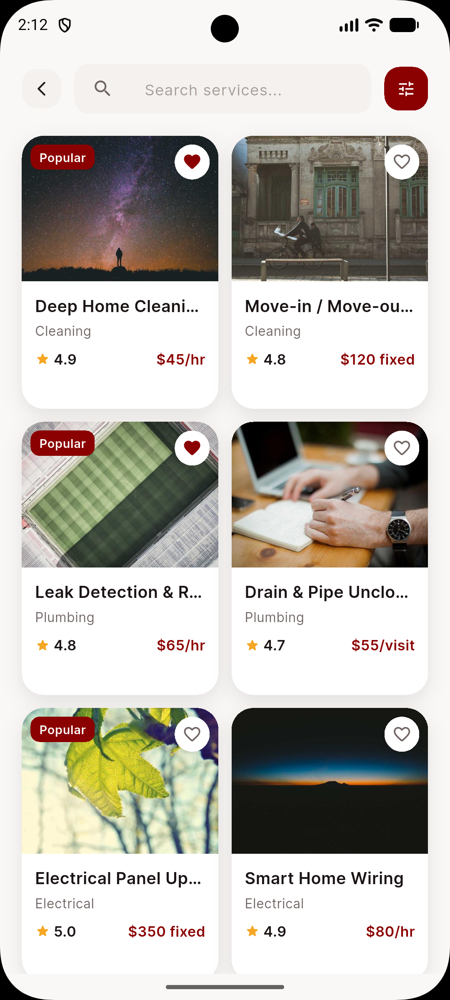
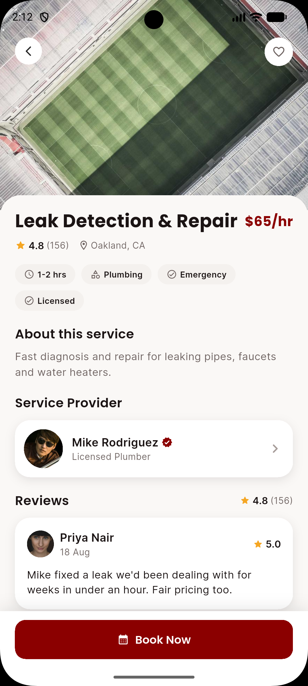
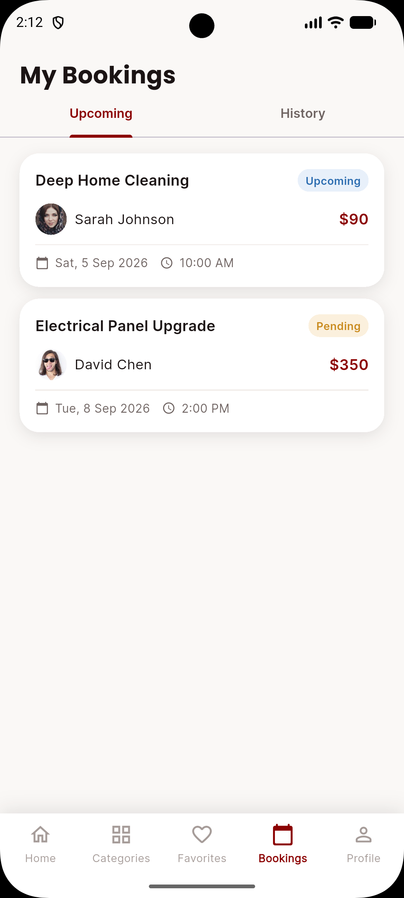
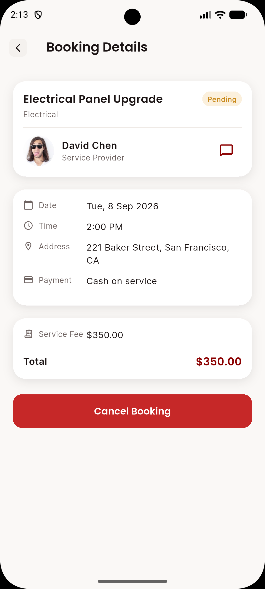
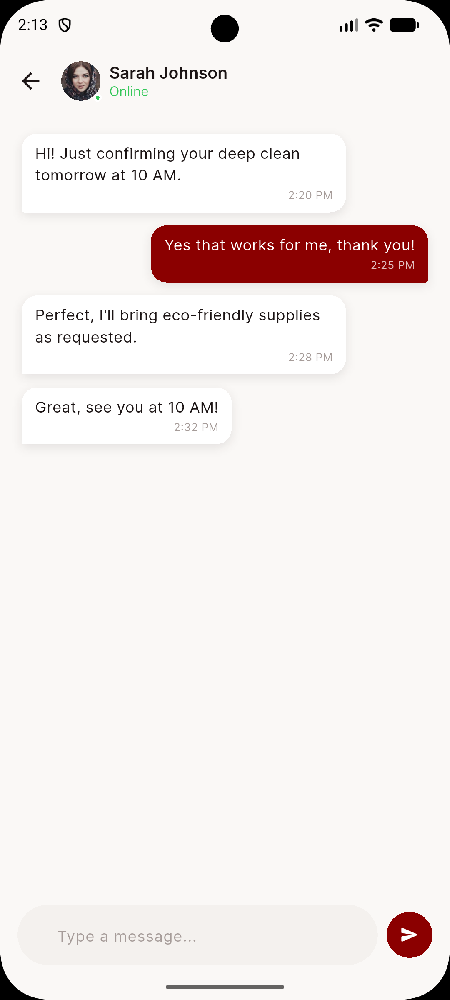
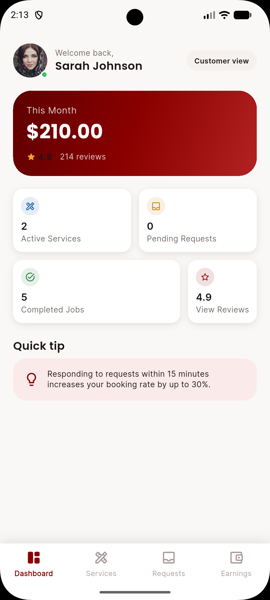
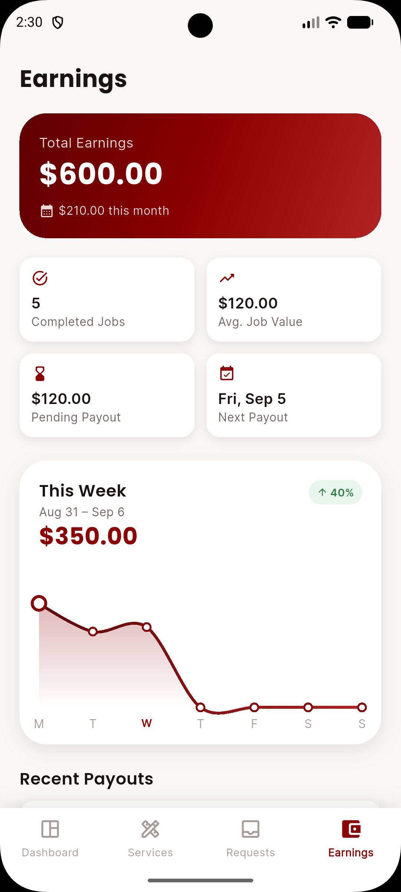
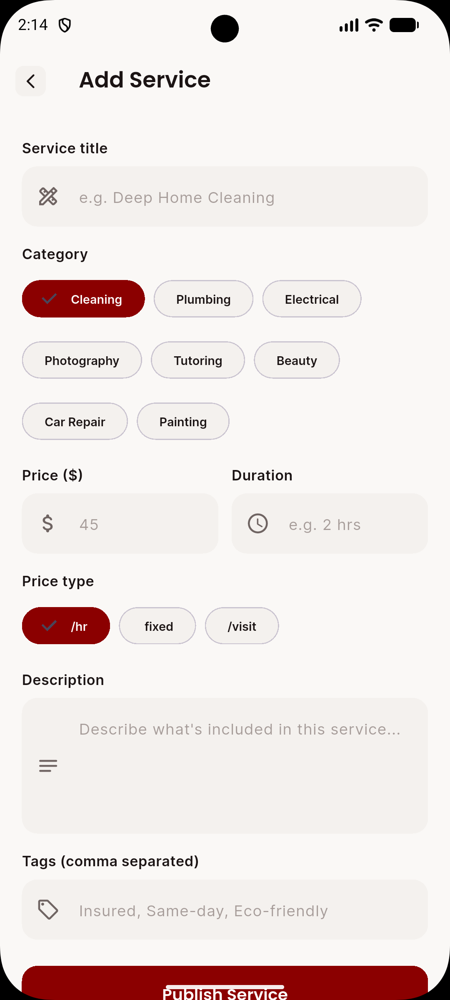

# Rimrid — Service Marketplace

A modern service marketplace app built with **Flutter + GetX + Clean Architecture**. Discover and book trusted local pros — cleaning, plumbing, electrical, photography, tutoring, beauty, car repair and more — or switch into **Provider Mode** to manage your own services, bookings and earnings.

The app currently runs entirely on realistic mock data — no backend integration yet — but every screen, controller and route is wired up as it would be in production, so swapping in real APIs later is a matter of replacing the data layer, not rebuilding the UI.

## Tech stack

- **Flutter** with **GetX** for state management, dependency injection and routing
- **Dio** pre-configured for future API integration
- **Clean, feature-based architecture** — `core/` (theme, constants, network, shared widgets, shared controllers) + `data/` (models, mock data) + `features/` (one folder per screen: `controllers/`, `bindings/`, `views/`)
- **Google Fonts**, a centralized color/typography system, and a `ResponsiveHelper` built on `MediaQuery`/`LayoutBuilder` (no ScreenUtil)
- **fl_chart** for the earnings graph, **table_calendar** for booking date selection, **cached_network_image** + **shimmer** for image loading

## Design

Dark red (`#8B0000`) primary color on a clean, off-white background — rounded cards, soft shadows, and subtle animations throughout.

## Screenshots

<table>
  <tr>
    <td align="center" width="20%"><br/><sub>Home</sub></td>
    <td align="center" width="20%"><br/><sub>Categories</sub></td>
    <td align="center" width="20%"><br/><sub>Search & Filter</sub></td>
    <td align="center" width="20%"><br/><sub>Service Details</sub></td>
    <td align="center" width="20%"><br/><sub>My Bookings</sub></td>
  </tr>
  <tr>
    <td align="center" width="20%"><br/><sub>Booking Details</sub></td>
    <td align="center" width="20%"><br/><sub>Chat</sub></td>
    <td align="center" width="20%"><br/><sub>Provider Dashboard</sub></td>
    <td align="center" width="20%"><br/><sub>Provider Earnings</sub></td>
    <td align="center" width="20%"><br/><sub>Add / Edit Service</sub></td>
  </tr>
</table>

## Features

**Customer**: Splash · Onboarding · Login/Signup · Home · Categories · Search & Filter · Service Details · Provider Details · Favorites · Booking · Booking Confirmation · My Bookings · Booking Details · Chat · Notifications · Profile · Settings

**Provider mode**: Dashboard · My Services · Add/Edit Service · Booking Requests (accept/decline) · Earnings (with a weekly trend chart) · Reviews

## Getting started

```bash
flutter pub get
flutter run
```

Android, iOS and Windows desktop are all configured as run targets.
